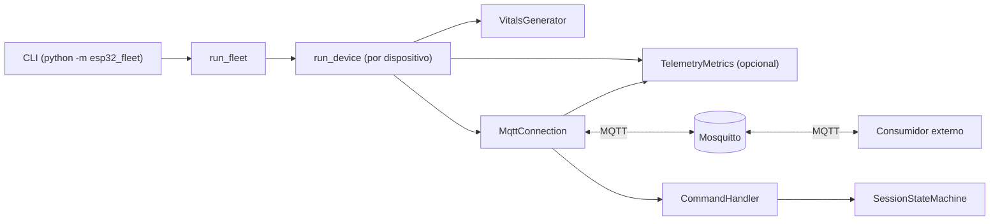
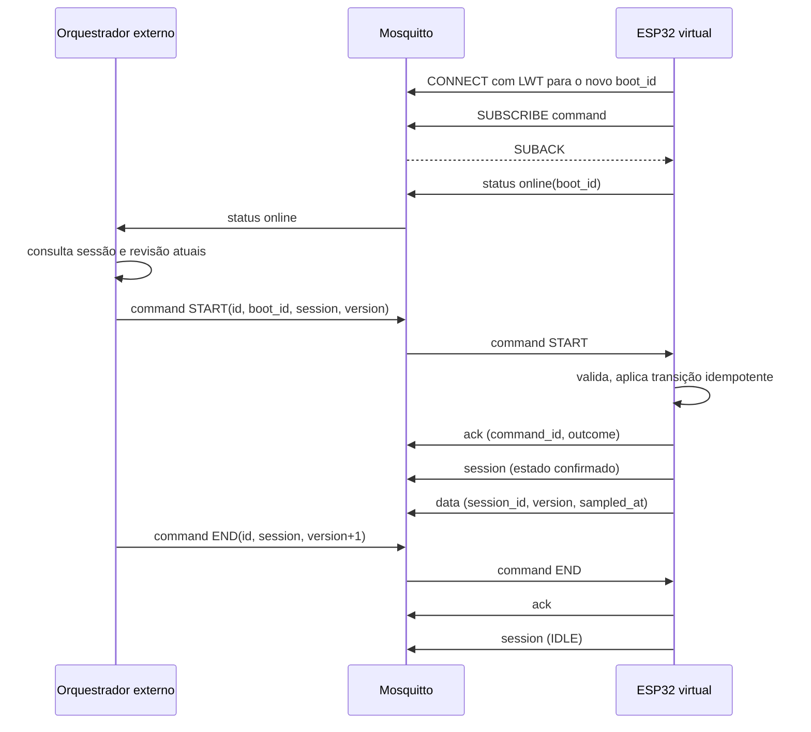

# Arquitetura do ESP32 Fleet Simulator — MQTT

Esta página descreve a arquitetura do simulador na versão `0.1.0`.

## 1. Objetivo e limites

O projeto simula uma frota de dispositivos ESP32 que envia frequência cardíaca, frequência respiratória e temperatura para um broker MQTT externo ou local. Ele é um repositório independente do VetMonitor. O simulador não persiste prontuários, não conhece dados identificáveis de pacientes e não oferece um cadastro de pacientes. A associação a pacientes ocorre no consumidor externo, como o VetMonitor, mediante sessões referenciadas por UUID.

**Referência de carga** — Até 50 dispositivos, com uma leitura a cada dois segundos por dispositivo durante cerca de cinco minutos. No teto do ensaio, a taxa nominal é de 25 mensagens de telemetria por segundo. O cenário clínico é sintético e o simulador não tem validação como dispositivo médico.

## 2. Decisões estruturais e alternativas

| Tema | Alternativa A | Alternativa B | Escolha e consequência |
| --- | --- | --- | --- |
| Concorrência | `asyncio` + `aiomqtt`: coordenação de tarefas com baixa sobrecarga de I/O | `paho-mqtt` + threads + `queue.Queue`: mais direto para bibliotecas síncronas, mais threads | **A**. Grande número de clientes e tarefas de temporização de I/O; demanda disciplina para impedir bloqueio do event loop. Ganho de performance requer medição, não é presumido. |
| Isolamento de dispositivos | Uma conexão/client MQTT por ESP32: identifica o LWT e falha de cada dispositivo | Um cliente compartilhado: menos conexões e recursos, mas LWT/falhas menos realistas | **Uma conexão por dispositivo**, com tamanho de frota configurável e ensaio de até 50 dispositivos. |
| Protocolo | MQTT 3.1.1: compatível com a maior parte dos clientes | MQTT 5: propriedades avançadas, expiração e códigos de motivo ricos | **MQTT 3.1.1** no MVP; evolução controlada para MQTT 5 por ADR. |
| Modelo de payload | JSON + Pydantic: legível e fácil de inspecionar | Protobuf/MessagePack: menor payload, maior custo operacional | **JSON + Pydantic**, com `schema_version` e limites explícitos. |
| Dependências | Poetry com lockfile | uv com lockfile | **uv** e dependências registradas no `uv.lock`. |
| Sessões | Autoridade no consumidor/orquestrador externo | Autoridade local em cada ESP32 | **Autoridade externa**. O dispositivo valida e confirma mudanças, mas não escolhe o paciente. |
| Recuperação de sessão | O dispositivo solicita a sessão atual. O pedido dá ao dispositivo controle sobre novas tentativas, mas exige definir uma solicitação no contrato MQTT. | O VetMonitor reconcilia ao receber `status online`. Aproveita os canais existentes e depende de processar o anúncio e confirmar o comando. | **Reconciliação pelo VetMonitor**. Cada conexão tem um `boot_id` próprio, e o controlador obtém o vínculo atual no backend antes de enviar o comando. |

O simulador roda pela CLI e mantém o estado em memória. O broker Mosquitto
roda em outro processo, via Docker Compose ou instalação local.

## 3. Diagrama de componentes

`MqttConnection` assina o tópico de comandos do dispositivo e entrega o payload
ao `CommandHandler`. O consumidor externo é responsável pelo vínculo clínico.

## 4. Pacotes e classes principais

Os caminhos abaixo são relativos a `src/esp32_fleet`.

| Componente | Responsabilidade |
| --- | --- |
| `SimulatorSettings` em `config/settings.py` | Guarda as opções validadas da CLI. |
| `run_fleet` em `orchestration/fleet.py` | Atribui IDs e sementes e coordena as tarefas dos dispositivos. |
| `run_device` em `orchestration/application.py` | Executa os ciclos de coleta, aplica atrasos e omissões e publica as leituras com o vínculo de sessão. |
| `MqttConnection` em `mqtt/connection.py` | Publica com QoS 1, encaminha comandos e reutiliza o payload em novas tentativas. |
| `ConnectionPolicy` em `mqtt/reconnect.py` | Define o backoff, o jitter e o limite de tentativas. |
| `DevicePresence` em `mqtt/presence.py` | Prepara os anúncios retidos e o Last Will de cada conexão. |
| `CommandHandler` em `handlers/commands.py` | Valida comandos e prepara o ACK e o evento de sessão quando aplicável. |
| `VitalsGenerator` em `domain/vitals.py` | Gera os sinais sintéticos por semente nos perfis `baseline` e `temperature-rise`. |
| `SessionStateMachine` em `domain/sessions.py` | Aplica transições, revisões e regras de idempotência para o boot em uso. |
| `SessionBinding` em `domain/models.py` | Guarda o vínculo imutável capturado por uma leitura. |
| `TelemetryMetrics` em `observability/metrics.py` | Conta confirmações, omissões, falhas MQTT e reconexões. |

## 5. Concorrência: `asyncio` com `aiomqtt`

A CLI usa um event loop por processo. `asyncio.TaskGroup` coordena as tarefas da frota.
Cada dispositivo mantém um cliente MQTT, um ciclo de publicação, uma tarefa para
receber comandos e outra para o heartbeat. O handler processa os comandos de
sessão em sequência. Um lock serializa a publicação de telemetria e a troca de conexão.

Cada dispositivo aguarda a confirmação da leitura atual antes de seguir para o próximo
ciclo. Durante uma tentativa de recuperação, o payload pendente fica em memória.
QoS 1 permite duplicatas, e o consumidor pode deduplicar pelo `message_id`.
A fila de comandos de cada cliente MQTT tem capacidade de 128 mensagens por padrão,
configurável por `--command-queue-size`. O comando em processamento fica fora
da fila. Quando a fila lota, o `aiomqtt` avisa e descarta as mensagens que chegam
até abrir espaço. O controlador usa o ACK de aplicação para confirmar o comando.

Reconexão: cada dispositivo supervisiona sua conexão; falhas transitórias acionam backoff exponencial com jitter e teto, cancelável no encerramento. Cada nova conexão renova o `boot_id` antes de preparar o LWT. O dispositivo publica `online` depois que o broker confirma a assinatura de comandos. A política de reconexão e os testes ficam a cargo de `ConnectionPolicy`, com um único loop de reconexão por dispositivo.

**Medição de carga** — Com 50 dispositivos e 150 amostras por dispositivo, o assinante espera 7.500 publicações de `data`. O total de mensagens no broker também inclui status, sessões, ACKs e cenários. O ensaio registra entrega por sequência, duplicatas, vazão e latências p50 e p95. Consulte o [procedimento e o resultado medido](development.md#ensaio-de-carga).

A carga estável também registra CPU e memória residente do processo do simulador. Um ensaio separado reinicia o broker e mede quando cada dispositivo volta a publicar com um novo `boot_id`. Consulte o [procedimento e os resultados](development.md#ensaio-de-recursos-e-tempo-de-recupera%C3%A7%C3%A3o). Se um consumidor futuro depender intensamente de APIs síncronas, compare medições antes de adotar threads.

## 6. Ciclo de vida do dispositivo e da sessão

Estados de sessão: `IDLE`, `ACTIVE`. `START` associa uma sessão em `IDLE` ou atualiza a revisão da mesma sessão em `ACTIVE`. `END` exige o `session_id` ativo e leva a `IDLE`. Cada novo comando aplicado tem revisão estritamente maior que a última aplicada. A recuperação do vínculo e a deduplicação de comandos seguem os [contratos MQTT](contracts.md#3-sessões-idempotência-e-ordenação).

A associação entre `session_id` e paciente está exclusivamente no VetMonitor. O dispositivo virtual nunca recebe nome ou cadastro. A leitura captura `session_id`, `session_version`, `sampled_at` e `sequence_number` **no instante da geração**, não no instante do envio. Uma mensagem antiga não é reatribuída à sessão atual. Leituras emitidas sem sessão contêm `session_id: null`, úteis apenas para testes e não para prontuário. O receptor externo valida o vínculo e o intervalo temporal; o simulador não pode garantir essa verificação.

Uma nova conexão começa em `IDLE`. `CommandHandler` valida o `boot_id` antes de
consultar a revisão. O consumidor externo pode restabelecer a sessão pelo fluxo
abaixo. Leituras geradas mantêm o `boot_id`, a sequência e o vínculo de origem
quando reenviadas por uma nova conexão. A leitura pendente em memória é perdida
se o processo for encerrado antes da entrega.

## 7. Gestão de falhas e segurança

- LWT publica `offline` em `status`, `retain=true`, QoS 1. Em parada limpa, publicar `offline` explicitamente antes de `DISCONNECT`.
- `status` é informação de conectividade; sessão clínica não se encerra automaticamente ao ficar offline. Timeout e alertas dependem do consumidor.
- O broker de desenvolvimento aceita conexões anônimas pelo loopback do host. Autenticação, permissões por tópico e TLS são evoluções planejadas.
- Cada dispositivo usa `client_id` único e previsível dentro do namespace do ambiente; conexões de instâncias distintas não podem compartilhar IDs.
- O código valida o tamanho do payload. A CLI permite configurar quantidade de dispositivos, intervalo e duração em ciclos. O benchmark aceita até 50 dispositivos.
- Relógio: usar UTC e `boot_id` + sequência. Latência de rede e relógios divergentes são limitações medidas; consumidores não devem confiar apenas no timestamp emitido.
- Testes: schemas, transições, idempotência, reconexão, ordenação, duplicatas, atraso entre sessões, LWT, graceful shutdown e carga de até 50 dispositivos.

## 8. Documentação das decisões

Ver `docs/adr/0001-asyncio-aiomqtt.md`, `0002-connection-per-device.md` e `0003-mqtt-contract-versioning.md`.
