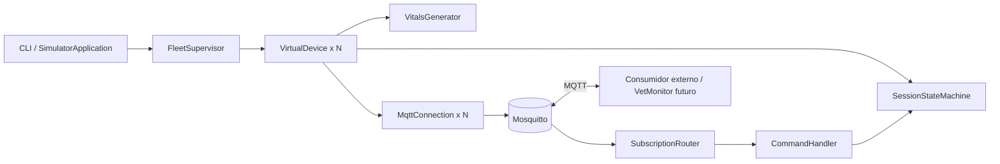

# Arquitetura do ESP32 Fleet Simulator — MQTT

Status: proposta arquitetural para revisão; implementação de negócio pendente.

## 1. Objetivo e limites

O projeto simula uma frota de dispositivos ESP32 que envia frequência cardíaca, frequência respiratória e temperatura para um broker MQTT externo ou local. Ele é um repositório independente do VetMonitor. O simulador não persiste prontuários, não conhece dados identificáveis de pacientes e não oferece um cadastro de pacientes. A associação a pacientes ocorre no consumidor externo, como o VetMonitor, mediante sessões referenciadas por UUID.

**Referência de carga** — Até 50 dispositivos, com uma leitura a cada dois segundos por dispositivo durante cerca de cinco minutos. No teto do ensaio, a taxa nominal é de 25 mensagens de telemetria por segundo. O cenário clínico é sintético e o simulador não tem validação como dispositivo médico.

## 2. Decisões estruturais e alternativas

| Tema | Alternativa A | Alternativa B | Escolha e consequência |
| --- | --- | --- | --- |
| Concorrência | `asyncio` + `aiomqtt`: coordenação de tarefas com baixa sobrecarga de I/O | `paho-mqtt` + threads + `queue.Queue`: mais direto para bibliotecas síncronas, mais threads | **A**. Grande número de clientes e tarefas de temporização de I/O; demanda disciplina para impedir bloqueio do event loop. Ganho de performance requer medição, não é presumido. |
| Isolamento de dispositivos | Uma conexão/client MQTT por ESP32: identifica o LWT e falha de cada dispositivo | Um cliente compartilhado: menos conexões e recursos, mas LWT/falhas menos realistas | **Uma conexão por dispositivo**, com limite configurável e testes de recursos. |
| Protocolo | MQTT 3.1.1: compatível com a maior parte dos clientes | MQTT 5: propriedades avançadas, expiração e códigos de motivo ricos | **MQTT 3.1.1** no MVP; evolução controlada para MQTT 5 por ADR. |
| Modelo de payload | JSON + Pydantic: legível e fácil de inspecionar | Protobuf/MessagePack: menor payload, maior custo operacional | **JSON + Pydantic**, com `schema_version` e limites explícitos. |
| Dependências | Poetry com lockfile | uv com lockfile e distribuição moderna | **uv**, disponível no ambiente de montagem; `uv.lock` é gerado quando houver resolução de dependências. |
| Sessões | Autoridade no consumidor/orquestrador externo | Autoridade local em cada ESP32 | **Autoridade externa**. O dispositivo valida e confirma mudanças, mas não escolhe o paciente. |
| Recuperação de sessão | O dispositivo solicita a sessão atual. O pedido dá ao dispositivo controle sobre novas tentativas, mas exige definir uma solicitação no contrato MQTT. | O VetMonitor reconcilia ao receber `status online`. Aproveita os canais existentes e depende de processar o anúncio e confirmar o comando. | **Reconciliação pelo VetMonitor**. Cada conexão tem um `boot_id` próprio, e o controlador obtém o vínculo atual no backend antes de enviar o comando. |

Não há banco de dados nem interface web no simulador. O Mosquitto roda em Docker e não compõe o código Python.

## 3. Diagrama de componentes

O `SubscriptionRouter` é instanciado por conexão e entrega comandos ao dispositivo correspondente. O broker não valida identidade do paciente; a decisão de associação é de responsabilidade do consumidor externo.

## 4. Pacotes e classes principais

A tabela representa interfaces e classes planejadas. Os módulos ainda não têm implementação.

| Camada / classe (caminho) | Faz | Não faz | Colaboradores | Ciclo de vida / estado |
| --- | --- | --- | --- | --- |
| Configuração: `SimulatorSettings` (`src/esp32_fleet/config/settings.py`) | Valida parâmetros e limites de execução | Não abre conexões | `SimulatorApplication` | Objeto imutável por execução |
| Conexão: `MqttConnection` (`mqtt/connection.py`) | Conecta, publica, assina e expõe eventos, com timeout e encerramento | Não interpreta payload clínico ou sessão | `ConnectionPolicy`, `SubscriptionRouter` | Uma instância por dispositivo; estado conectado/desconectado |
| Conexão: `ConnectionPolicy` (`mqtt/reconnect.py`) | Calcula backoff exponencial com jitter, limite de tentativas e critérios de falha | Não publica mensagens | `MqttConnection` | Uma por conexão; contador de tentativas |
| Conexão: `TopicCatalog` (`mqtt/topics.py`) | Constrói e valida tópicos e níveis MQTT | Não serializa dados | `MqttConnection`, `SubscriptionRouter` | Stateless, reutilizável |
| Assinatura: `SubscriptionRouter` (`mqtt/router.py`) | Associa filtros a handlers e distribui mensagens recebidas | Não executa regras de sessão | `MqttConnection`, `CommandHandler` | Uma instância por dispositivo, registro de handlers |
| Assinatura: `InboundQueue` (`mqtt/inbound_queue.py`) | Enfileira mensagens com capacidade definida e política de pressão | Não executa operações de negócio | `SubscriptionRouter`, `CommandHandler` | Uma por dispositivo; buffer limitado |
| Handlers: `CommandHandler` (`handlers/commands.py`) | Valida envelope/comando e solicita transição de sessão; emite confirmação | Não conhece paciente nem abre socket | `CommandSchema`, `SessionStateMachine`, `MessagePublisher` | Uma por dispositivo, sem estado clínico próprio |
| Handlers: `MessagePublisher` (`handlers/publisher.py`) | Serializa modelos validados e publica eventos/leituras com QoS apropriado | Não gera sinais nem escolhe sessão | `MqttConnection`, `TopicCatalog` | Uma por dispositivo, sem buffer durável |
| Domínio: `VirtualDevice` (`domain/device.py`) | Orquestra ciclo de leitura do dispositivo virtual e suas dependências | Não gerencia outros dispositivos nem o broker | `VitalsGenerator`, `SessionStateMachine`, `MessagePublisher` | Uma instância por dispositivo, estado operacional |
| Domínio: `VitalsGenerator` (`domain/vitals.py`) | Produz série sintética correlacionada por random walk com sementes | Não transporta MQTT nem identifica paciente | `ScenarioEngine`, `VitalsReading` | Uma por dispositivo, estado fisiológico sintético |
| Domínio: `ScenarioEngine` (`domain/scenarios.py`) | Aplica atraso, perda de conexão e anomalias configuradas | Não altera sessão sem comando | `VitalsGenerator`, `VirtualDevice` | Uma por dispositivo, estado de cenário |
| Domínio: `SessionStateMachine` (`domain/sessions.py`) | Aplica transições, revisão monotônica e idempotência de comandos | Não consulta prontuário ou banco do VetMonitor | `CommandHandler`, `SessionBinding` | Uma por dispositivo; sessão/revisão em memória |
| Domínio: `SessionBinding` (`domain/models.py`) | Representa referência de sessão, sem PII | Não consulta cadastro | `SessionStateMachine`, `VitalsReading` | Valor imutável por revisão |
| Domínio: `VitalsReading` (`domain/models.py`) | Representa leitura tipada, sequência e instante de amostragem | Não publica MQTT | `VitalsGenerator`, `MessagePublisher` | Valor imutável por amostra |
| Orquestração: `FleetSupervisor` (`orchestration/fleet.py`) | Cria/limita N dispositivos, distribui início/parada e recolhe métricas | Não implementa regras fisiológicas | `VirtualDevice`, `SimulatorSettings` | Uma por execução; tarefas e estado da frota |
| Orquestração: `SimulatorApplication` (`orchestration/application.py`) | Composition root, sinais de OS e shutdown ordenado | Não valida payload de comandos diretamente | `FleetSupervisor`, `SimulatorSettings` | Uma por processo |
| Observabilidade: `TelemetryMetrics` (`observability/metrics.py`) | Contabiliza publicações, erros, reconexões e latências | Não mantém dados de pacientes | `FleetSupervisor`, `MqttConnection` | Uma por execução, contadores seguros para event loop |

Interfaces internas propostas: `MqttTransport`, `ReadingSink`, `CommandSink` como `typing.Protocol` no pacote `ports/`; permitem testar sem broker. Estas interfaces não substituem os contratos públicos MQTT.

## 5. Concorrência: `asyncio` com `aiomqtt`

Usar um event loop por processo; cada ESP32 possui uma instância de cliente MQTT e tarefas de publicação, recepção e supervisão. `asyncio.TaskGroup` coordena tarefas com escopo de vida definido. O acesso a estado de sessão ocorre em uma única tarefa responsável ou sob `asyncio.Lock` quando múltiplos consumidores podem alterar o estado. Operações bloqueantes devem ser evitadas no event loop; integrações síncronas futuras usam adaptadores e `asyncio.to_thread` quando necessário.

A fila de entrada terá limite configurável; comandos não podem ser descartados silenciosamente. Quando a capacidade acabar, registrar erro, interromper processamento da conexão ou aplicar estratégia de rejeição observável. A fila de saída é limitada e não garante persistência em disco. QoS 1 significa entrega ao menos uma vez entre os participantes do protocolo, **não** entrega exatamente uma vez à aplicação. A aplicação usa IDs idempotentes e, quando necessário, reconciliação.

Reconexão: cada dispositivo supervisiona sua conexão; falhas transitórias acionam backoff exponencial com jitter e teto, cancelável no encerramento. Cada nova conexão renova o `boot_id` antes de preparar o LWT. O dispositivo publica `online` depois que o broker confirma a assinatura de comandos. A política de reconexão e os testes ficam a cargo de `ConnectionPolicy`, com um único loop de reconexão por dispositivo.

**Medição de carga** — Com 50 dispositivos e 150 amostras por dispositivo, o assinante espera 7.500 publicações de `data`. O total de mensagens no broker também inclui status, sessões, ACKs e cenários. O ensaio registra entrega por sequência, duplicatas, vazão e latências p50 e p95. Consulte o [procedimento e o resultado medido](development.md#ensaio-de-carga).

A carga estável também registra CPU e memória residente do processo do simulador. Um ensaio separado reinicia o broker e mede quando cada dispositivo volta a publicar com um novo `boot_id`. Consulte o [procedimento e os resultados](development.md#ensaio-de-recursos-e-tempo-de-recupera%C3%A7%C3%A3o). Se um consumidor futuro depender intensamente de APIs síncronas, compare medições antes de adotar threads.

## 6. Ciclo de vida do dispositivo e da sessão

Estados de sessão: `IDLE`, `ACTIVE`. `START` associa uma sessão em `IDLE` ou atualiza a revisão da mesma sessão em `ACTIVE`. `END` exige o `session_id` ativo e leva a `IDLE`. Cada novo comando aplicado tem revisão estritamente maior que a última aplicada. A recuperação do vínculo e a deduplicação de comandos seguem os [contratos MQTT](contracts.md#3-sessões-idempotência-e-ordenação).

A associação entre `session_id` e paciente está exclusivamente no VetMonitor. O dispositivo virtual nunca recebe nome ou cadastro. A leitura captura `session_id`, `session_version`, `sampled_at` e `sequence_number` **no instante da geração**, não no instante do envio. Uma mensagem antiga não é reatribuída à sessão atual. Leituras emitidas sem sessão contêm `session_id: null`, úteis apenas para testes e não para prontuário. O receptor externo valida o vínculo e o intervalo temporal; o simulador não pode garantir essa verificação.

Ao desconectar, `VirtualDevice` libera o vínculo local usado na geração de novas amostras. `SessionStateMachine` começa a nova conexão em `IDLE` e `CommandHandler` valida o `boot_id` antes de consultar a revisão. O VetMonitor pode restabelecer a sessão pelo mesmo fluxo após uma falha de rede ou uma reinicialização. Leituras já geradas mantêm seu `boot_id`, sequência e vínculo, mesmo se publicadas por uma nova conexão. Reiniciar o processo também perde as leituras que ainda estavam no buffer em memória.

## 7. Gestão de falhas e segurança

- LWT publica `offline` em `status`, `retain=true`, QoS 1. Em parada limpa, publicar `offline` explicitamente antes de `DISCONNECT`.
- `status` é informação de conectividade; sessão clínica não se encerra automaticamente ao ficar offline. Timeout e alertas dependem do consumidor.
- Comando: autenticar dispositivo e controlador por credenciais distintas, ACL de publicar/assinar por tópico; TLS quando fora da rede local. Nenhuma senha em código ou repositório.
- Cada dispositivo usa `client_id` único e previsível dentro do namespace do ambiente; conexões de instâncias distintas não podem compartilhar IDs.
- Limitar tamanho de payload, taxa, dispositivos, duração da simulação e logs; nunca registrar senha ou dados identificáveis.
- Relógio: usar UTC e `boot_id` + sequência. Latência de rede e relógios divergentes são limitações medidas; consumidores não devem confiar apenas no timestamp emitido.
- Testes: schemas, transições, idempotência, reconexão, ordenação, duplicatas, atraso entre sessões, LWT, graceful shutdown e carga de até 50 dispositivos.

## 8. Documentação das decisões

Ver `docs/adr/0001-asyncio-aiomqtt.md`, `0002-connection-per-device.md` e `0003-mqtt-contract-versioning.md`.
