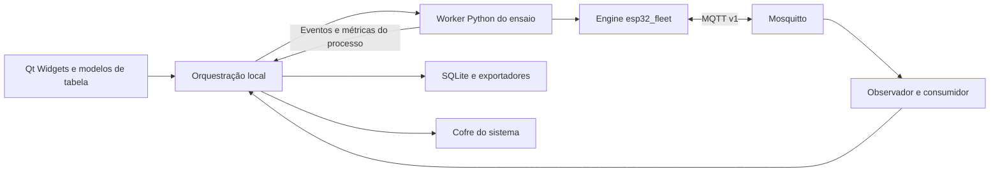

# Arquitetura proposta para a interface de controle

A aplicação desktop usa PySide6/Qt Widgets em Windows e Linux. O simulador Python
continua sendo a fonte de geração, sessão e transporte. A GUI combina o estado
da execução local com as mensagens MQTT de um ensaio. Veja os [wireframes](wireframes.md)
e o [contrato MQTT v1](../contracts.md).

## Componentes



| Camada | Responsabilidade |
| --- | --- |
| Interface | Formulários, navegação, seleção e confirmação visual das ações. Usa modelos Qt para tabelas e `pyqtgraph` para gráficos ao vivo. |
| Orquestração | Valida a configuração, cria a execução, supervisiona o worker, correlaciona comandos e entrega atualizações em lote à UI. |
| Worker | Executa a engine e o observador MQTT fora da thread gráfica. No MVP, o escopo de isolamento é o ensaio. |
| Persistência | Guarda presets, execução congelada, leituras aceitas e amostras de métricas em SQLite. Escreve em lote fora da thread gráfica. |
| Cofre | Resolve referências de credenciais do sistema operacional. O worker recebe apenas os valores necessários à conexão. |

O primeiro controle usa `python -m esp32_fleet` para reproduzir o fluxo da CLI.
O consumidor pode iniciar como subprocesso de `scripts/consume_telemetry.py`,
lendo JSON Lines de `stdout` e diagnósticos de `stderr`. Ações por dispositivo
entram no worker quando houver um ponto de controle na engine. Em Windows, o
worker MQTT usa o event loop Selector adotado pela CLI atual.

A linha de produção de eventos permanece fora da thread gráfica. O worker
envia atualizações agregadas por dispositivo para a UI a cada 250 ms como ponto
de partida. A tabela atualiza as linhas alteradas por `device_id`. Eventos de
estado, ACKs e registros persistidos mantêm sua ordem na origem. Os gráficos
recebem séries limitadas à janela selecionada, e o histórico é lido em páginas.
A partição em vários workers será dimensionada pelo ensaio de escala com a
capacidade observada de sockets e pelo comportamento do broker.

## Inventário de ações e entradas

A coluna **Disponível na main** indica os pontos de entrada que o projeto já
oferece na revisão `948342c`. A última coluna identifica o próximo trabalho para
expor cada ação de forma coerente na GUI e no terminal.

| Recurso | Disponível na main | Suporte que a GUI precisa |
| --- | --- | --- |
| Identidade e grupo | `--device-id`, `--devices` e geração de sufixo | Prever IDs, conferir duplicatas entre grupos e salvar perfis. |
| Cenário e semente | `--scenario` e `--seed` | Gerar e guardar uma semente explícita. Parâmetros livres do gerador exigem um contrato na engine. |
| Cadência e fim do ensaio | `--samples`, `--interval` e encerramento pelo operador | Duração total como condição de parada no worker, com equivalente de terminal. |
| Atraso e omissão | `--delay-every`, `--delay-seconds` e `--omit-every` | Conversão de ms para s. Taxa de falha simulada exige suporte na engine. |
| Fila de comandos | `--command-queue-size`, padrão 128. Excedentes geram aviso e são descartados. | Expor a política atual. Profundidade e descartes por dispositivo exigem instrumentação. |
| Broker e sessão de transporte | `--broker`, `--port` e configuração interna de `client_id` e sessão limpa | A UI mostra as opções atuais. Keepalive, modelo de `client_id` e clean session configuráveis exigem novos parâmetros. |
| Autenticação e TLS | Variáveis de usuário, senha e CA. O perfil local aplica ACL por papel. | Usar credenciais distintas de `simulator` e `controller`. Certificado e chave de cliente exigem extensão. A tela explica a regra do perfil e pode testar entrega autorizada. |
| Iniciar e parar | CLI de um dispositivo e de uma frota. Cancelamento encerra o ensaio. | Supervisão do ciclo de vida e controle individual de membros de uma frota. |
| Pausa, retomada e queda | Reconexão automática e testes locais de Last Will e retomada | Controles explícitos por dispositivo. A pausa suspende a coleta mantendo a conexão. A queda abrupta encerra o transporte sem o anúncio normal para exercitar o Last Will. |
| Sessão | Tópicos de `START`/`END`, ACK e evento. A CLI atua como dispositivo. | Um publicador de comandos no papel `controller`, acessível pela GUI e por um comando de terminal. |
| Métricas | `--metrics` emite contadores por dispositivo ao encerrar | Alimentação em tempo real pela engine. Latência de ACK e ocupação da fila ganham fonte própria. |
| Consumo | `scripts/consume_telemetry.py` valida VitalsDataV1 e deduplica `message_id` | Expor o fluxo no painel. Contar descartes e duplicatas exige sinal antes da filtragem. |
| Presets, histórico e relatórios | Benchmark e registros de saída da CLI | Serviço compartilhado pela GUI e por um comando de exportação e histórico. |

A ação **Copiar comando CLI** usa os parâmetros realmente suportados e aciona o
fluxo documentado para as credenciais via ambiente. Ações novas ganham um
equivalente de terminal na entrega que implementar seu ponto de controle. Para
iniciar uma frota reproduzível com recursos atuais, o comando tem esta forma.

```console
uv run --locked python -m esp32_fleet --devices 3 --device-id esp32 --scenario baseline --seed 42 --samples 4 --interval 2 --metrics
```

## Modelo de dados

Os horários persistidos usam UTC. Os números de sequência e as revisões
mantêm o significado do contrato MQTT. Chaves locais incluem a execução
quando o mesmo `device_id` puder aparecer em ensaios diferentes.

| Entidade | Campos principais | Identidade e ciclo de vida |
| --- | --- | --- |
| `Config` | ID, versão, identidade da frota, cenário, semente, cadência, duração, perturbações e fila, referência do broker | Um preset pode gerar várias versões. A execução guarda uma cópia congelada. |
| `Fleet` | ID, nome, grupos, versão do preset e regra de IDs | Agrupa a configuração que será reaplicada em outros ensaios. |
| `Run` | `run_id`, configuração congelada, revisão da engine, hash, horários e resultado | Uma ocorrência de execução que agrupa dispositivos e resultados de exportação. |
| `Device` | `run_id`, `device_id`, conectividade, `boot_id`, sessão, última leitura, referência de métricas | Uma linha por dispositivo e execução. O boot atual muda durante a reconexão. |
| `Session` | `session_id`, dispositivo, `boot_id` aplicado, revisão, estado, referência sintética e ACKs | Um vínculo lógico pode ser restabelecido em novo boot com revisão maior. |
| `Reading` | `message_id`, `device_id`, `boot_id`, sequência, sessão, `sampled_at`, horário de recebimento, FC, FR e temperatura | Guarda o contexto da coleta. O histórico usa `run_id` e `message_id` como chave única para leituras persistidas. |
| `MetricsSnapshot` | `run_id`, escopo, instante, janela, valores e fonte dos contadores | Série agregada de um dispositivo ou da frota, com indicador de valores ausentes. |
| `Integration` | ID, broker, porta, TLS, perfil, referência do cofre, ambiente externo e evidência datada | Configuração do destino e histórico de verificações. O cofre guarda os segredos. |

A conectividade muda com `status` e com a observação de heartbeat. Antes do
primeiro anúncio, o estado é **Aguardando conexão**. A sessão usa `IDLE` e
`ACTIVE`, independente da conectividade. Ao receber um novo `boot_id`, a UI
passa a exibir o novo boot. Um ACK ou uma leitura anterior mantém o vínculo
histórico e é identificado como evento daquele boot. Um Last Will é registrado
no horário em que foi observado pelo consumidor.

## Contrato entre a UI e a engine

O contrato local tem versão própria. Pedidos carregam `run_id`, `operation_id`,
ação e alvo. O worker devolve erros e resultados pelo mesmo `operation_id`.
Eventos trazem `worker_id`, uma sequência crescente por worker, `run_id` e o
horário de observação. O acesso aos dados do worker fica atrás do adaptador
para que a UI use o mesmo modelo com subprocesso ou com módulos da engine.

| Operação | Pedido da UI | Resultado observado |
| --- | --- | --- |
| Iniciar ensaio | Configuração congelada, semente, IDs e integração | Execução inicializada ou erro com motivo. As linhas ficam aguardando anúncio do broker. |
| Parar ensaio ou dispositivo | ID da execução e alvos | Encerramento do worker ou do dispositivo, último estado e métricas finais. |
| Pausar ou retomar | Execução e dispositivo | Confirmação do worker e alteração do ciclo de coleta. |
| Reconectar ou forçar queda | Execução e dispositivo | Resultado operacional e observação de `status`, novo `boot_id` ou Last Will quando aplicável. |
| Abrir ou encerrar sessão | Dispositivo, boot ativo, sessão e revisão | ACK correlacionado com o `command_id` MQTT e resultado por dispositivo. |
| Testar integração | Broker, perfil e verificação solicitada | Etapas executadas, resultado e horário. |
| Ler atualização | Identidade da execução e escopo da tela | Lote de dispositivos alterados, leituras, métricas ou eventos. |

Uma ação iniciada na UI fica pendente até confirmação ou timeout. O sucesso de
transporte e a aplicação de sessão têm evidências distintas. Comandos de sessão
usam `command_id` para deduplicação e `boot_id` para garantir o destino. A
revisão é monotônica por dispositivo, inclusive após reconectar. Quando outro
controlador é a autoridade da sessão, a GUI acompanha o fluxo. O controle
manual da GUI usa um ambiente e dispositivos de ensaio sob uma única autoridade.

O detalhamento de erros usa código operacional, fase, alvos e motivo. Logs e
exportações incluem referência de configuração e IDs sintéticos. Usuário e
senha ficam no cofre ou no ambiente da execução. Os relatórios carregam
identificadores de perfis e a evidência de teste, com omissão dos segredos.

### Exemplo de pedido e evento

Os exemplos usam IDs abreviados para facilitar a leitura. A interface atribui
`operation_id` quando o operador inicia a ação. Ao publicar no broker, o
worker gera o `command_id` MQTT correspondente e mantém a correlação até o
ACK ou o timeout.

```json
{
  "version": 1,
  "kind": "command",
  "run_id": "ensaio-42",
  "operation_id": "op-17",
  "action": "open_session",
  "target": {"device_id": "esp32-001", "boot_id": "boot-atual"},
  "payload": {"session_id": "sessao-sintetica", "session_version": 2}
}
```

```json
{
  "version": 1,
  "kind": "event",
  "event": "session_ack",
  "run_id": "ensaio-42",
  "operation_id": "op-17",
  "worker_id": "worker-1",
  "sequence_number": 24,
  "observed_at": "2026-11-23T17:50:00Z",
  "payload": {"command_id": "cmd-51", "accepted": true, "state": "ACTIVE"}
}
```

## Métricas, histórico e reprodutibilidade

| Indicador | Fonte e definição |
| --- | --- |
| Leituras por segundo | Taxa de leituras únicas observadas no consumidor na janela selecionada. O painel indica a diferença para o contador de confirmações. |
| Confirmações, omissões, falhas MQTT e reconexões | Contadores da engine. Mantêm a semântica de `samples_acked`, `samples_omitted`, `mqtt_errors` e `reconnections`. |
| Taxa de omissão | Omissões divididas pelos ciclos de coleta efetivamente executados na janela, quando o denominador estiver disponível. |
| Latência de ACK | Tempo monotônico entre enviar o comando e observar o ACK de aplicação com o mesmo `command_id`. Timeouts aparecem como resultados próprios. |
| Ocupação da fila | Comandos em espera por dispositivo e capacidade configurada. O comando em processamento tem campo separado. |
| Duplicatas e lacunas | Deduplicação pela janela de `message_id` e análise de sequência por dispositivo e boot. Um salto de sequência é uma lacuna observada. A causa depende da configuração e dos contadores do ensaio. |

Um ensaio reproduzível congela a versão da configuração, a semente, o cenário,
a quantidade, os IDs e a revisão da engine. O hash SHA-256 cobre uma
serialização JSON canônica dessa configuração efetiva e da revisão, em UTF-8,
com chaves ordenadas. O histórico avisa se a semente ou o cenário mudou entre
ensaios. UUIDs de mensagens, boots e horários são gerados por execução. A
paridade de reprodução compara os valores dos sinais por dispositivo e posição.
A derivação da semente de cada membro segue a ordem global da frota da CLI,
inclusive quando uma execução for dividida entre workers.

As exportações de leituras aceitas usam CSV, JSON ou Parquet. Os relatórios
HTML e PDF incluem a configuração congelada, o hash, os gráficos, as versões,
o ambiente e os resultados medidos. A exportação e a consulta ao histórico
executam fora da thread da UI. A API local é uma extensão opcional e pode
reutilizar o serviço de consulta ao estado após o MVP.

## Integração e critérios de validação

- A tela de integrações usa o [contrato versionado](../contracts.md) como fonte
  dos tópicos, QoS e payloads. Os snippets Python e Node.js terão teste de
  assinatura, validação de telemetria v1 e deduplicação em um broker isolado.
- A conexão MQTT e a homologação do VetMonitor têm estados próprios. **Pendente**
  indica ausência de configuração, **Configurada** indica destino registrado
  e **Ativa** requer evidência de troca de mensagens com o VetMonitor em homologação.
- Os testes do MVP cobrem criação da frota, execução/parada e paridade de
  sinais entre GUI e CLI. Os testes de sessão cobrem ACK correlacionado,
  transição de estado, Last Will e novo boot com metadados originais de reenvio.
- A referência de 50 dispositivos recebeu **7.500 de 7.500** leituras em
  **300,547 s** com CPU média de **0,738%** de um processador lógico, pico
  observado de **51,914 MiB RSS** e retomada de todos em até **1,049 s** após
  o retorno da porta do broker. A UI usa 50 como limiar inicial configurável
  de aviso. [Procedimento e resultados](../development.md#ensaio-de-recursos-e-tempo-de-recupera%C3%A7%C3%A3o)
- O teste de escala planeja **500 dispositivos por 10 minutos**. O relatório
  vai comparar a GUI com o modo de terminal na mesma carga e ambiente,
  registrando throughput, perdas, CPU, memória, latência de atualização da
  tabela e responsividade aos comandos locais. As medições orientam o número
  de conexões por worker e registram o limite observado de cada plataforma.
- A referência de sanidade é o [CI da main em 948342c](https://github.com/joaorodrigues12/esp32-fleet-simulator-mqtt/actions/runs/45103207387),
  com 113 testes aprovados em cada plataforma. A versão publicada de referência
  é [v0.1.0](https://github.com/joaorodrigues12/esp32-fleet-simulator-mqtt/releases/tag/v0.1.0).

A entrega funcional começa com ajuda em PT-BR e mensagens separadas da lógica
de exibição para adicionar EN. O [guia do projeto](../../README.md#in%C3%ADcio-r%C3%A1pido)
documenta o fluxo de broker, consumidor e frota que o tutorial da GUI vai reproduzir.
